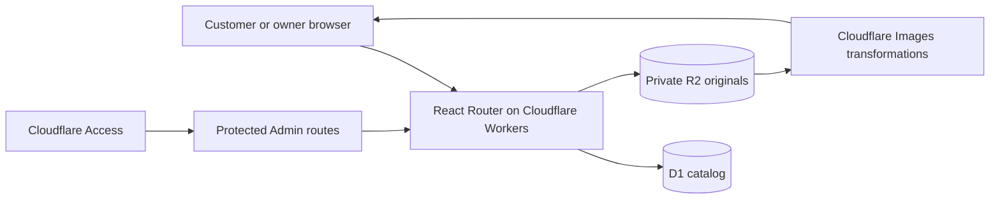

# Jewelry Catalog Platform — portfolio case study

**Live demo:** [Velaform Studio Preview](https://protected-cloudflare-preview-jewelry-catalog-platform.shugegogogo.workers.dev/)  
**Source:** [jewelry-catalog-platform](https://github.com/Eronshu/jewelry-catalog-platform)  
**Stack:** React Router, TypeScript, Cloudflare Workers, D1, R2, Images, Access

## The problem

A small jewelry business needs a visual catalog that its owner can update
without editing code. Customers should be able to browse on a phone, inspect
photos and availability, and continue a purchase conversation through the
owner's existing sales channel. The first version intentionally has no cart or
payment flow.

The business launch is scheduled for later, so the current site uses the
fictional **Velaform Studio** identity and clearly labeled demo inventory. It
shows the product and its engineering without presenting synthetic items as
real merchandise.

## The solution

- The storefront renders Home, Shop, category and product views. Shop queries D1
  in batches of 24 and supports search, filters, sorting, and Load More.
- Product media is stored privately in R2 and delivered at card, detail, and
  zoom sizes. The media handler checks product visibility before serving a
  fresh response; transformed images can remain cached until they expire.
- The Admin supports the product lifecycle and photo management through a
  visual interface. Access controls protect its routes, and the Worker checks
  signed identity assertions before serving Admin data or actions.
- A separate Worker Preview has dedicated D1 and R2 resources. Its moving and
  immutable URLs were checked for public browsing and Admin protection.

## Engineering choices

| Choice                                              | Reason                                                                                                                        |
| --------------------------------------------------- | ----------------------------------------------------------------------------------------------------------------------------- |
| Server-side catalog queries                         | Avoid downloading all products just to filter a few; keep pagination practical as the catalog grows.                          |
| Private image originals and transformed delivery    | Keep source images out of the public bucket while serving sizes suited to each view.                                          |
| Draft, available, sold, hidden, and archived states | Let the owner manage real product changes without deleting records.                                                           |
| Access plus Worker identity validation              | Protect both the edge entry point and the application route.                                                                  |
| Deterministic 300-item demo generator               | Make a realistic browsing demonstration reproducible without committing hundreds of binary files or using real business data. |

## Verification

The repository's CI runs formatting, lint, type checks, automated tests, and a
production build. The demo import verified 300 products and 300 matching images
in the isolated Preview, with 75 products in each of four categories. Home,
Shop, product pages, and images were checked on both Preview URL forms;
unauthenticated Admin requests were challenged by Access. See the
[Preview runbook](./PROTECTED_PREVIEW_RUNBOOK.md) and
[demo data guide](./PORTFOLIO_DEMO.md) for boundaries and cleanup procedures.

## Scope and next steps

This is a **portfolio demonstration**, not a launched business or a
checkout-enabled store. The demo brand, product descriptions, prices, and
illustrations are fictional; Home also includes temporary design-review
photography. The Preview is marked `noindex`, and its Admin has no public
credentials.

Before a real launch, replace the demo content with the owner's brand and
inventory, confirm the sales and contact workflow, configure a production
domain and isolated production resources, and complete production security,
backup, accessibility, device, and search-indexing checks. Direct checkout,
payments, shipping, and order management would be a separate product phase.
